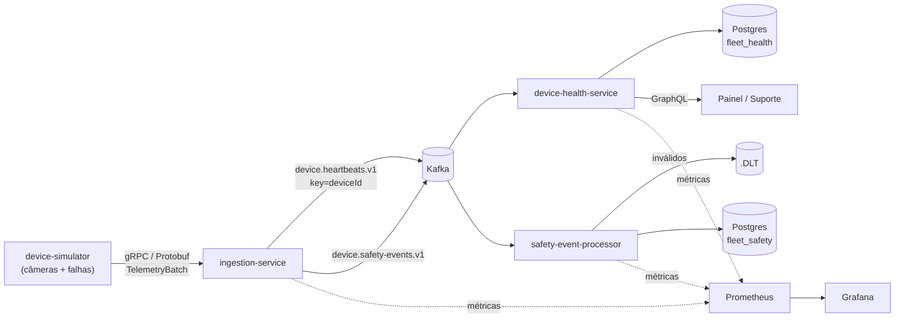

# FleetCam

Pipeline de telemetria para **câmeras veiculares com IA**: da câmera em campo ao painel, com foco em
**confiabilidade, observabilidade e investigação de problemas com dados reais**.

Projeto de portfólio que reproduz, em escala pequena, os problemas do dia a dia de um time de IoT Vídeo:
cartões SD falhando, dispositivos em reboot loop, rede instável, duplicados, firmware com bug e
alarmes que mentem.

   

## Destaques

- 🔎 **[Postmortem 001](docs/postmortems/001-firmware-clock-skew.md):** um alarme de SLO de latência que, investigado com SQL, era na verdade um bug de fuso horário no firmware. As queries rodam no CI e reproduzem cada número citado.
- 🩺 **Saúde de dispositivos:** máquina de estados (`ACTIVE` / `DEGRADED` / `OFFLINE`) com regras para cartão SD, reboot loop, relógio desviado e ausência de sinal, além de histórico de transições para o Suporte.
- 📈 **SLOs com alertas de burn rate**, dashboards no Grafana e [runbooks](docs/runbooks) escritos para quem está de plantão.
- 🧪 **Simulador de frota** com injeção de falhas reais de campo.
- 📝 **[ADRs](docs/adr)** explicando os trade-offs; comunicação para [Suporte](docs/communication/001-support-notice.md) (PT) e para o [fornecedor](docs/communication/001-vendor-report.md) (EN).

## Arquitetura

<p align="center">
  
</p>

<details>
<summary>Versão em Mermaid (texto, fácil de editar)</summary>



</details>

| Módulo | Responsabilidade |
|---|---|
| [`contracts`](contracts) | `.proto` (contrato com o firmware), eventos Kafka e `ClockMath` (aritmética de tempo segura) |
| [`ingestion-service`](services/ingestion-service) | Gateway gRPC: valida, carimba `received_at` e publica no Kafka; só confirma ao device após `acks=all` |
| [`device-health-service`](services/device-health-service) | Consome heartbeats, avalia regras de saúde, detecta offline e expõe API GraphQL |
| [`safety-event-processor`](services/safety-event-processor) | Grava eventos de IA de forma idempotente, corrige relógio, envia inválidos para a DLT e mede a latência do SLO |
| [`device-simulator`](device-simulator) | Frota simulada com buffer local, at-least-once e falhas injetáveis |
| [`analytics`](analytics) | Dataset sintético e queries da investigação (DuckDB, portáveis para Snowflake) |

## Rodando

Pré-requisitos: JDK 21, Docker.

```bash
make infra            # Kafka, Postgres, Prometheus, Grafana, Kafka UI

# em terminais separados
make run-ingestion
make run-health
make run-safety
make simulate         # 50 câmeras saudáveis + câmeras com falhas

# ou tudo em containers
make up-all
```

| O quê | Onde |
|---|---|
| Grafana (dashboard "FleetCam") | http://localhost:3000 |
| GraphiQL (saúde da frota) | http://localhost:8082/graphiql |
| Kafka UI | http://localhost:8090 |
| Prometheus (alertas) | http://localhost:9091/alerts |

Exemplo de consulta no GraphiQL:

```graphql
{
  fleetHealthSummary { totalDevices byState { state count } openIssues { type count } }
  devices(state: DEGRADED) {
    id firmwareVersion
    openIssues { type detail }
    transitions(last: 3) { from to reason at }
  }
}
```

### Falhas injetáveis

```bash
make simulate FAULTS=sd_card_degrading:3,firmware_clock_skew:10
```

| Falha | O que acontece | Onde aparece |
|---|---|---|
| `sd_card_degrading` | erros de escrita crescem até o cartão ficar somente leitura | `SD_CARD_WRITE_ERRORS` → `SD_CARD_READ_ONLY` |
| `flaky_connectivity` | 30% dos envios falham, backlog cresce, 10% dos acks se perdem | batches maiores, `outcome=duplicate` |
| `firmware_clock_skew` | firmware 2.3.1 com relógio 3h atrasado | `CLOCK_SKEW`, painel de desvio por firmware, `clock.corrected` |
| `reboot_loop` | o device trava ~3 min após cada boot | `REBOOT_LOOP` |
| `goes_dark` | para de enviar dados | `OFFLINE` após 5 min |
| `bad_gps` | eventos com GPS (0,0) | DLT + alerta `SafetyEventsDeadLettered` |

### Verificando de ponta a ponta

```bash
make demo             # sobe tudo em containers e confere o fluxo completo
make smoke            # só a verificação, com os serviços já rodando localmente
```

O smoke test confere, em ordem: serviços saudáveis → gateway aceitando telemetria → devices registrados
via GraphQL → eventos gravados → falhas injetadas detectadas → Prometheus coletando métricas.

### Investigação com SQL

```bash
make investigate      # gera ~72 mil eventos sintéticos e roda as 7 queries do postmortem
```

## Testes

```bash
./gradlew test
```

- **Unitários** para as regras de saúde, a aritmética de relógio, o mapeamento do protobuf e as validações. As regras são funções puras, sem Spring e sem I/O.
- **Integração com Testcontainers** (Kafka + Postgres reais): duplicados absorvidos, inválidos na DLT e relógio corrigido antes de gravar.
- **CI** ([`.github/workflows/ci.yml`](.github/workflows/ci.yml)): build, testes, validação das regras do Prometheus com `promtool` e reprodução dos números do postmortem.

## Decisões técnicas

| ADR | Decisão |
|---|---|
| [0001](docs/adr/0001-kafka-partitioning-by-device.md) | Particionar por `deviceId` para garantir ordem por device |
| [0002](docs/adr/0002-grpc-for-device-ingestion.md) | gRPC + batch para ingestão (vs. REST e MQTT) |
| [0003](docs/adr/0003-idempotency-and-dlt.md) | Idempotência por `message_id`; DLT para eventos, descarte para heartbeats |
| [0004](docs/adr/0004-three-timestamps.md) | Três timestamps por mensagem; nunca misturar relógios |

## Limitações conhecidas

Escolhas conscientes para manter o escopo, e o que eu faria em produção:

| Limitação | Em produção |
|---|---|
| gRPC sem TLS: qualquer cliente pode enviar dados em nome de qualquer `device_id` | mTLS com certificado por device; o `device_id` vem do certificado, não do payload |
| GraphQL sem autenticação | OAuth2/JWT com escopo por cliente (um cliente só vê a própria frota) |
| Capacidade não medida: o health service faz algumas queries e um lock por heartbeat | Teste de carga (`ghz`) para achar o limite; processamento em lote se for o gargalo |
| Postmortem 001 usa dataset sintético | Postmortem 002 com dados exportados do próprio sistema rodando |
| Vídeo representado só por `clipId` | Pipeline de upload de clipes (ver próximos passos) |
| Kafka e Postgres com uma réplica | Replicação 3 / `min.insync.replicas=2`; Postgres com réplica |

## Próximos passos

- [ ] Fluxo de upload de clipes de vídeo (S3/MinIO) com retomada de upload interrompido
- [ ] Testes de integração do ingestion (gRPC) e do health service; teste de carga com números no README
- [ ] Tracing com OpenTelemetry atravessando gRPC → Kafka → consumers
- [ ] Painel React consumindo a API GraphQL
- [ ] Rollout de firmware em canário com gate automático nas métricas de saúde
- [ ] Sidecar de visão computacional (YOLO/MediaPipe) gerando eventos a partir de vídeos públicos de direção
- [ ] Exportar métricas para Datadog via OpenTelemetry

